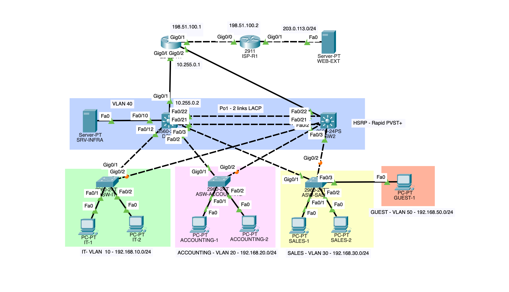
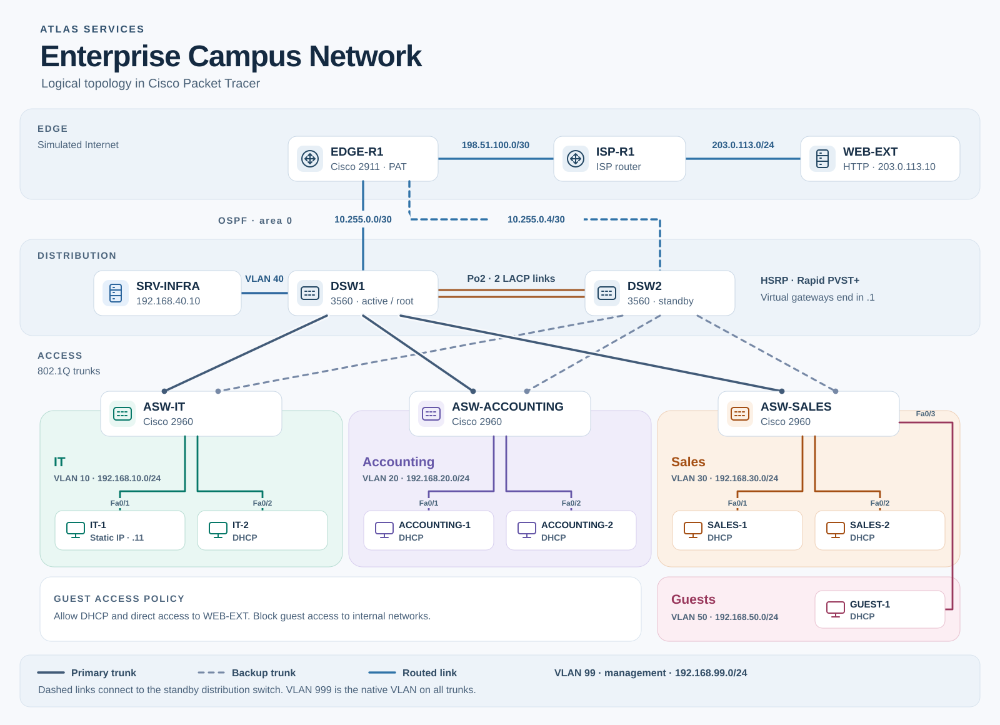

# Enterprise Campus Network Lab

I designed and built an enterprise campus network in Cisco Packet Tracer for Atlas Services, a fictional company with IT, Accounting, and Sales teams. Seven PCs represent the departments and the guest network. The lab covers VLAN segmentation, inter-VLAN routing, OSPF, HSRP, Rapid PVST+, LACP, DHCP relay, ACLs, SSH, and NAT overload.

## Topology

Each access switch has a trunk to each distribution switch. DSW1 normally serves as both the STP root and the active HSRP gateway. DSW2 can take over the virtual gateways and reach the edge router on its own routed link. The final inter-switch bundle is `Po2` on `Fa0/21–22`. The `Po1` annotation in the Packet Tracer capture predates that change.

## Test results

| Scenario | Observed result | Evidence |
| --- | --- | --- |
| Primary IT uplink disconnected | ASW-IT moved forwarding to `Gi0/2`. IT-1 reached `192.168.10.1` after the change, 4/4 replies. | [STP](screenshots/asw-it-stp-failover-root-port.png) · [Ping](screenshots/it-1-ping-via-backup-uplink.png) |
| DSW1 isolated | DSW2 took over the HSRP groups. EDGE-R1 learned the IT, Accounting, Sales, and Guest routes via `10.255.0.6`. IT-1 received 3/4 replies from WEB-EXT. | [HSRP](screenshots/dsw2-hsrp-dsw1-isolated.png) · [OSPF](screenshots/edge-r1-ospf-dsw1-isolated.png) · [Ping](screenshots/it-1-web-ext-dsw1-isolated.png) |
| Guest filtering during that isolation test | The guest reached WEB-EXT with 4/4 replies. Its ping to IT-1 was rejected by DSW2. | [Guest pings](screenshots/guest-1-filtering-dsw1-isolated.png) · [ACL counters](screenshots/dsw2-guest-acl-counters.png) |
| Normal operation restored | Both LACP members joined `Po2`. DSW1 resumed its active HSRP role on all six routed VLANs. | [LACP and STP](screenshots/dsw2-po2-lacp-stp-recovery.png) · [HSRP](screenshots/dsw1-hsrp-active-after-recovery.png) |

## Run the lab

1. Open [Enterprise-Campus-Network.pkt](packet-tracer/Enterprise-Campus-Network.pkt) in Cisco Packet Tracer 9.0.0. Use Realtime mode and allow the topology to converge.
2. On DSW1 and DSW2, run `show etherchannel summary` and `show standby brief`. On EDGE-R1, run `show ip ospf neighbor`.
3. From IT-1, ping the virtual gateway `192.168.10.1` and the external test server `203.0.113.10`. Check the translation on EDGE-R1 with `show ip nat translations`.
4. Follow the [verification guide](verification/README.md) for access-control and failover tests. Use a copy of the `.pkt` for failure testing.

After opening the lab, run the [guest and department filtering checks](verification/README.md#filtering-after-reopening). The [traffic policy guide](documentation/security.md#inter-vlan-and-guest-filtering) gives the commands to restore the bindings if Packet Tracer loses them on reload.

SRV-INFRA connects only to DSW1. The lab uses one EDGE-R1 and one simulated ISP router. The distribution failure tests demonstrate gateway and path recovery for already addressed clients. The recorded tests did not measure convergence time or demonstrate DHCP and DNS availability during a full DSW1 isolation.

## Repository contents

- [Network design, VLANs, IP addressing, and port map](documentation/network-design.md)
- [Traffic policies and management access](documentation/security.md)
- [Troubleshooting notes](documentation/troubleshooting.md)
- [Verification steps and recorded results](verification/README.md)
- [IOS configuration exports](configs/README.md)

## Project references

- The organization of the design, troubleshooting, and verification files draws on the [Hospital Network Design Project by dayseanm04](https://github.com/dayseanm04/Hospital-Network-Design-Project).
- I also consulted two Packet Tracer campus labs. [Enterprise Campus Network by Olina Kundu](https://github.com/OlinaKundu/enterprise-campus-network) · [Campus Network Configuration Lab by AhmS3cOps](https://github.com/AhmS3cOps/Campus-Network-Configuration-Lab)
